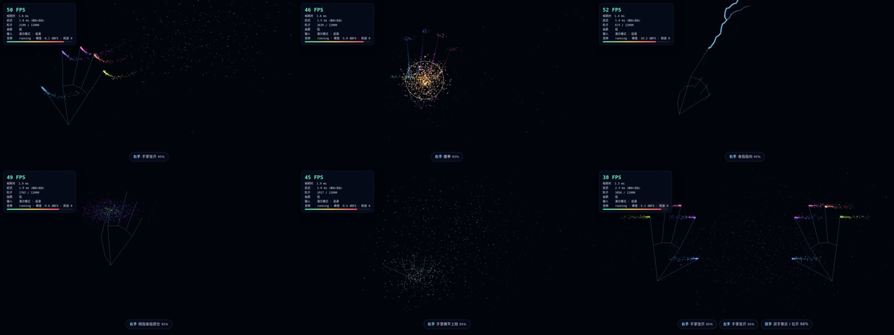

# Gesture Particle Studio · 手势交互粒子引擎

摄像头实时手势识别（MediaPipe 21 关键点）→ 规则分类 → three.js GPU 粒子 → Web Audio 合成音效。纯网页，数据全部在本机处理，不上传。



## 一、快速开始（非技术人员照做即可）

1. 安装 [Node.js 18 或更高版本](https://nodejs.org/)（一路“下一步”）。
2. 打开终端，进入本目录：
   ```bash
   cd gesture-particle-studio
   npm install      # 首次运行：安装依赖，并自动复制 MediaPipe WASM、下载手部模型（约 7.5 MB）
   npm run dev      # 启动
   ```
3. 用 **Chrome / Edge** 打开 <http://127.0.0.1:5173>，点击 **「启动摄像头」** 并允许摄像头权限。
   没有摄像头时点 **「演示模式」**，会用合成手自动巡演全部手势。
4. 打包为静态网页：`npm run build`，产物在 `dist/`，可直接部署到任意静态服务器（摄像头需要 `https` 或 `localhost`）。本地预览打包结果：`npm run preview`。

> 模型下载失败（如网络受限）时程序会自动改用 Google / jsDelivr CDN 加载，不影响使用。

## 二、手势说明

| 手势 | 判定依据（`src/gestures/classifier.js`） | 粒子状态 | 音效层 |
|---|---|---|---|
| 手掌张开 | 五指伸直，指尖间距 / 掌长 ≥ `open.minSpreadRatio` | 拖尾：五指指尖牵引彩色光带 + 辉光渐隐 | 空气嗡鸣 + sweep（`air`） |
| 握拳 | 四指弯曲（关节夹角 < `finger.extendAngle`）+ 拇指收拢 | 闪爆：进入瞬间由拳心向外爆炸，火花 + 冲击环 + 闪光 | 低频冲击 + 噪声 + 碎裂高频（`impact`） |
| 食指指向 | 仅食指伸直 | 闪电：指尖沿指向生成锯齿电弧，随机分叉（双手时连向另一只手） | 电流噼啪 + 高压嘶鸣（`electric`） |
| 拇指食指捏合 | 拇指尖–食指尖距离 / 掌长 < `pinch.enter`（滞回到 `pinch.exit`） | 漩涡：粒子绕捏合点旋转成吸积盘并跟随移动 | 旋转上升音 + 吸入低音（`vortex`） |
| 手掌摊平上抬 | 掌心法向朝上（`palmUp.normalUp`）且掌心向上移动（`palmUp.riseSpeed`） | 四散飞舞：弱重力彩色粒子缓慢漂浮 | 空灵 pad + 细碎风铃（`pad`） |
| 双手靠近 / 拉开 | 同时检测到两只手，按两掌心距离映射 0~1 | 漩涡 / 爆点半径随距离缩放（`dual.radiusScale`） | 音高随距离滑动（`pitch`，`dual.pitchHz`） |
| 无手 / 丢失 | 无手或置信度 < `minHandConfidence`，宽限 `lostGraceMs` 后判定 | 粒子缓慢回落为待机背景粒子流 | 环境底噪，静默过渡（`ambient`） |

状态切换：参数在 `transitionSeconds`（默认 0.45 s）内插值；每次切换播放过渡音。特效可叠加（如“食指指向”= 闪电 + 30% 拖尾）。

**演示模式快捷键**：`1` 张开 · `2` 握拳 · `3` 指向 · `4` 捏合 · `5` 摊平上抬 · `6` 双手 · `0` 无手 · `A` 恢复自动巡演（手动模式下鼠标控制手的位置）。
**通用快捷键**：`H` 隐藏/显示面板 · `V` 摄像头画面 · `K` 手部骨架。

URL 参数（方便演示 / 录屏）：`?demo` 直接进入演示，`?demo=pinch&lock` 锁定某个手势，`&hidepanel` 隐藏面板，`&skeleton` 显示骨架，`&theme=neon`，`&quality=0|1|2`。

## 三、界面与性能

- 左上角 HUD 实时显示 **FPS、单帧耗时、延迟、推理耗时、粒子数、画质、音频峰值 dBFS 与削波计数**。
  - 摄像头模式延迟 = 摄像头采集时间戳 → 本帧渲染完成（浏览器不支持时退化为“推理 + 渲染”）。
- 画质三档：低 1.2 万粒子 / 中 3 万 + 辉光 / 高 6 万 + 全分辨率辉光。平均帧率低于 `minFps` 时自动降一档，持续高于 `recoverFps` 时自动升回。
- 面板可切换配色主题（极光 / 熔岩 / 霓虹 / 黑白）、隐藏摄像头画面只保留粒子层、调粒子上限、总音量和每个音效层开关。
- **截图 / 录屏** 按钮：导出 PNG / WebM，画面左下角自动叠加帧率与延迟标注；录屏包含合成音效。

## 四、配置文件（改值后刷新页面即可生效）

| 文件 | 内容 |
|---|---|
| `public/config/gestures.json` | **手势 ↔ 特效 ↔ 音效映射表**：每个手势的特效 id + 权重、音效 id + 音量、进入瞬间触发的特效/音效、过渡时长、双手缩放与音高范围 |
| `public/config/particles.json` | **粒子参数表**：画质档位、自动降级阈值、辉光、配色主题，以及每种特效的出生率、寿命、速度、阻尼、重力、尺寸、色相等 |
| `public/config/audio.json` | 总音量、淡入淡出时间、压缩器 / 限幅器、软削波、混响、每个音效层的开关与最大音量 |
| `public/config/recognition.json` | 识别参数：最多手数、置信度阈值、MediaPipe 设置（GPU/CPU、模型路径）、One Euro 平滑、各手势判定阈值、防抖时长 |

距离类阈值均按“掌长”（手腕→中指根）归一化，远近手都适用。

## 五、架构与扩展接口

```
src/
  tracking/   handTracker.js（MediaPipe HandLandmarker, VIDEO 模式）  simulatedHands.js + handModel.js（演示用合成 21 点手）
  gestures/   features.js（距离/夹角特征） classifier.js（规则注册表 + 模型接口） stabilizer.js（防抖/丢失宽限） oneEuro.js（关键点平滑） interpreter.js
  particles/  engine.js（6 万容量粒子池, TypedArray） effects/*.js（每种特效一个插件） renderer.js（three.js 着色器点精灵 + 条带 + Bloom）
  audio/      engine.js（压缩→限幅→软削波→主音量, 共享混响） layers.js（每个音效层一个插件） dsp.js
  ui/         hud.js  recorder.js（截图/录屏+标注）
  main.js     主循环：采集 → 识别 → 映射 → 粒子/音频 → 渲染 → 性能统计
```

**新增手势**
```js
import { gestureRules } from './gestures/classifier.js';
gestureRules.register('victory', {
  priority: 35,                    // 数值越小越先判定（内置：捏合 10、握拳 20、指向 30 …）
  test: (f) => f.extended[0] && f.extended[1] && !f.extended[2] && !f.extended[3], // [食指, 中指, 无名指, 小指]
});
```
然后在 `gestures.json` 的 `gestures` 里加 `"victory": { "label": "剪刀手", "effects": [...], "sounds": [...] }`。

**接入模型分类器**（替代或补充规则）
```js
import { setModelClassifier } from './gestures/classifier.js';
setModelClassifier((landmarks, features) => myModel.predict(landmarks)); // 返回手势 id 或 null（null 时回退规则）
```
并把 `recognition.json` 的 `classifier` 设为 `"model"`。

**新增粒子模式**：在 `src/particles/effects/` 新建文件，导出 `{ create(params) { return { update, integrate, onEnter?, draw? } } }`，在 `effects/index.js` 中 `effectRegistry.register('id', def)`，参数写进 `particles.json` 的 `effects.id`。

**新增音效**：在 `src/audio/layers.js` 中 `soundLayers.register('id', { oneShot?, create({ ctx, noise, reverb }) { return { input, update?(params, level, dt), trigger?(evt) } } })`（`input` 为该层输出节点，引擎负责淡入淡出推子与压缩限幅），并在 `audio.json` 的 `layers` 中加同名条目、在 `gestures.json` 中引用，界面会自动出现开关。

## 六、验证结果

单元测试：`npm test`（手势规则在左右手 / 旋转 / 缩放下的判定、摊平上抬、防抖、双手距离、丢失回落，共 10 项）。

截图与录屏（`docs/`）由 `npm run capture` 生成（需先 `npm run dev`，并以 `--remote-debugging-port=9222` 启动 Chrome）：

- `docs/screenshot-*.png`：每种手势一张，HUD 中有 FPS / 延迟。
- `docs/demo-recording.webm`：完整巡演 31 秒，左下角叠加 FPS / 延迟。
- `docs/demo-metrics.json`：每种手势的平均 FPS、帧耗时、延迟、粒子数。

测试机为**无显卡的云端虚拟机（SwiftShader 软件渲染）**，演示模式 1280×720，自动降级到“低”档后：

| 手势 | 平均 FPS | 帧耗时（CPU） | 延迟（模拟+渲染） | 粒子峰值 |
|---|---|---|---|---|
| 手掌张开 | 49 | 1.7 ms | 1.6 ms | 2168 |
| 握拳 | 46 | 1.9 ms | 1.9 ms | 2287 |
| 食指指向 | 48 | 1.3 ms | 1.3 ms | 688 |
| 捏合 | 49 | 1.8 ms | 1.8 ms | 1763 |
| 摊平上抬 | 51 | 1.7 ms | 1.7 ms | 1824 |
| 双手 | 43 | 2.4 ms | 2.4 ms | 3343 |
| 无手 | 52 | 1.4 ms | 1.3 ms | 850 |

录屏过程中（同时做画面合成 + VP9 编码）约 28–31 FPS；音频峰值约 −6 dBFS，削波计数 0。有独立显卡的电脑可稳定运行“高”档（6 万粒子 + 辉光）。虚拟机没有摄像头，**摄像头模式的推理耗时与采集→渲染延迟请在本机查看 HUD**。

## 七、常见问题

- **点了“启动摄像头”没反应**：确认浏览器地址是 `localhost` / `127.0.0.1` 或 `https`，并在地址栏左侧允许摄像头。
- **没有声音**：浏览器要求先点击页面才能播放声音；检查面板“音效”开关和音量。
- **卡顿**：保持“自动降级”勾选，或手动选“低”画质；确认浏览器设置中开启了硬件加速。
- **识别不准**：保持手在画面中央、光线充足；可在 `recognition.json` 调整阈值（如 `pinch.enter`、`finger.extendAngle`）。
