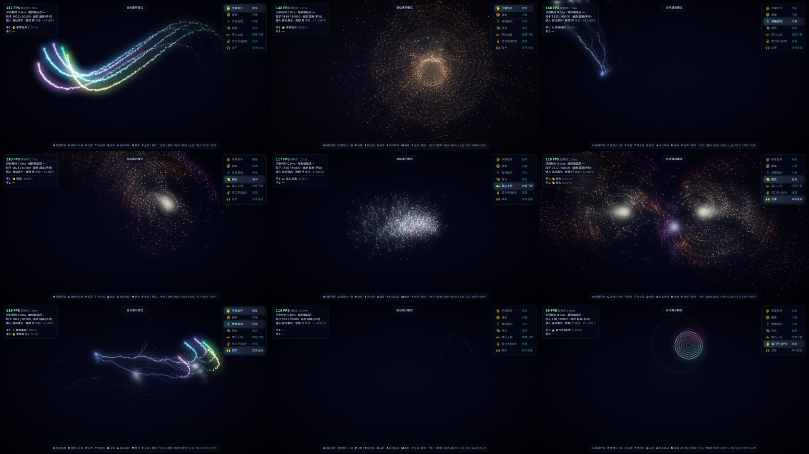

# 手势交互粒子引擎 · Gesture Particle Engine

摄像头实时识别手势，驱动 GPU 粒子特效，同时实时合成音效。纯网页实现，**不用安装任何 npm / pip 依赖**，用 Chrome 或 Edge 打开即可运行。



> 截图与录屏在 `docs/media/`，说明见文末“测试与验收记录”。

---

## 一、快速开始（非技术人员照做即可）

1. **安装 Python 3**（只用来开一个本地网页服务；Windows 安装时勾选 “Add to PATH”）。
2. **启动**
   - Windows：双击 `start.bat`
   - macOS / Linux：终端运行 `./start.sh`
   - 或者在项目目录手动运行：`python -m http.server 8000`，然后打开 <http://localhost:8000>
3. 在打开的页面上点 **📷 摄像头模式** → 允许摄像头权限 → 把手伸到摄像头前。

没有摄像头也能体验：

- **🖱 鼠标模拟**：移动鼠标 = 移动手掌，数字键切换手势，按住鼠标左键 = 握拳。
- **▶ 自动演示**：自动循环演示全部特效，适合展台、大屏或录屏。也可以直接打开 `http://localhost:8000/?demo=1`。

> ⚠️ 摄像头只能在 `localhost` 或 `https` 下打开。直接双击 `index.html` 用 `file://` 打开是**不行的**，必须通过上面的本地服务访问。

### 离线 / 展会环境

首次运行时，MediaPipe 的手部模型（约 8 MB）会从 CDN 下载。如果现场没有网络，提前在有网的地方运行一次：

```bash
python tools/download_vendor.py
```

依赖会下载到 `vendor/` 目录。之后程序检测到本地文件就会自动改用本地版本，不需要改任何配置。

---

## 二、手势 → 特效 → 音效

| 手势 | 怎么做 | 判定依据（规则） | 粒子特效 | 音效 |
| --- | --- | --- | --- | --- |
| 🖐 手掌张开 | 五指张开，掌心对着摄像头移动 | 四指伸直，且拇指外展 | **拖尾**：五个指尖各拉出一条彩色光带，带辉光、渐变和衰减 | 流动空气感的嗡鸣，随手速做 sweep 扫频 |
| ✊ 握拳 | 由张开快速握拳 | 四指全部弯曲 | **闪爆**：双层冲击波环 + 火花碎片 + 高速火星 + 屏幕闪光和震动；握住不放时冒余烬 | 下坠的低频爆响 + 瞬态“啪”声 + 碎裂高频 |
| ☝ 食指指向 | 只伸出食指 | 食指伸直，其余三指弯曲 | **闪电**：从指尖射出锯齿电弧，随机分叉；另一只手在场时，电弧会连到那只手的掌心 | 噼啪电流声 + 高压嘶鸣，按电弧落点左右声像 |
| 🤏 捏合 | 拇指尖与食指尖捏在一起 | 两指尖距离 / 手掌尺寸 < 0.26，且捏合点离掌心足够远（用来和握拳区分） | **漩涡**：三条旋臂组成的吸积盘，越转越快；附近粒子被卷入，核心发亮；跟随手移动 | 旋转上升音 + 吸入低音 + 风声 |
| 🫴 掌心上抬 | 手掌摊平、掌心朝上并向上抬 | 五指伸直，且掌心法线朝上（可改为“向上移动”判定） | **四散飞舞**：大量彩色粒子向四周漂浮，重力很弱，湍流中闪烁 | 空灵的铺底 pad + 细碎风铃 |
| 🙌 双手 | 两只手同时出现，靠近或拉开 | 两掌间距 / 屏宽 | 漩涡、爆点半径随两手距离缩放（0.55×～1.9×）；两掌之间出现能量连接流 | 连续音高跟随距离滑动：越近越高，所有持续音层一起变调 |
| — 无手 | 手离开画面 | 超过 0.25 秒没有检测到手 | 已有粒子在弱重力下慢慢回落，背景粒子流渐强 | 环境底噪慢慢淡入，静默过渡 |
| ✌ 剪刀手（插件示例） | 伸出食指和中指 | 插件规则 | 涟漪 | 水滴“叮” |

- **过渡**：每个特效都有独立的权重，0 → 1 淡入 0.35 秒、淡出 0.5 秒，并用 smoothstep 缓动。权重同时影响发射量、尺寸、亮度、力场强度、电弧长度和音量，所以切换不会跳变。
- **叠加**：两只手可以各做各的手势，特效同时生效（例如左手闪电 + 右手拖尾）。在 `config.js` 里给同一手势写多个模式，也能叠加。
- **防抖**：关键点先经过 One-Euro 滤波，再在 6 帧窗口里投票（至少 4 帧一致才切换）。握拳的门槛降了一档，保证“瞬间爆炸”。捏合用了迟滞阈值（进入 0.26，退出 0.36）。

## 三、快捷键

| 键 | 作用 | 键 | 作用 |
| --- | --- | --- | --- |
| H | 隐藏/显示全部界面（只留粒子层） | Q | 手动切换画质档位 |
| C | 摄像头小窗（带 21 点骨架） | A | 开关自动降级 |
| P | 设置面板（主题、音量、残影、辉光、各音效层开关） | M | 静音 |
| T | 切换配色主题（霓虹 / 极光 / 烈焰 / 寒冰） | F | 全屏 |

鼠标模拟模式：`1` 张开、`2` 握拳、`3` 指向、`4` 捏合、`5` 上抬、`7` 剪刀、`0` 无手、`6` 开关第二只手（镜像位置）、`Shift+数字` 单独设置第二只手。

URL 参数：`?demo=1` 自动演示，`?theme=aurora` 指定主题，`?quality=0~3` 固定画质（同时关闭自动降级）。

---

## 四、参数配置（`config/config.js`）

所有可调项都在这一个文件里，每项都有中文注释。改完保存，刷新浏览器就生效。

| 区块 | 作用 | 常改的项 |
| --- | --- | --- |
| `camera` | 摄像头分辨率、镜像、是否显示小窗 | `showPreview` |
| `tracking` | MediaPipe 置信度、丢失超时、关键点平滑、输入区域扩展 | `minDetectionConfidence`、`smoothing.minCutoff`（越小越稳但越拖）、`inputMargin` |
| `gestures` | 各手势的判定阈值、防抖窗口 | `pinchRatio`、`palmUp.mode` / `invertNormal`、`stabilizer` |
| **`mapping`** | **手势 ↔ 粒子模式 ↔ 音效层 映射表** | 改 `modes` / `sounds` 数组就能换绑或叠加 |
| `dual` / `idle` | 双手、无手状态的映射与缩放范围 | `minScale`、`maxScale` |
| `transition` | 淡入淡出时间（秒） | `fadeIn`、`fadeOut` |
| **`particles`** | **各粒子模式的参数表**（数量、寿命、尺寸、速度、阻尼、重力……） | 例如 `burst.debris`、`vortex.omega`、`lightning.branchChance` |
| `render` | 残影长度、辉光、曝光、默认主题 | `trailPersistence`、`bloom` |
| `performance` | 自动降级阈值与 4 档画质（发射量 / 粒子上限 / 渲染分辨率 / 辉光） | `targetFps`、`levels` |
| `audio` | 主音量、混响长度、各音效层开关与音量 | `layers.xxx.enabled` / `volume` |
| `themes` | 配色主题（背景渐变 + 每种特效的调色板） | 复制一份改颜色即可新增主题 |
| `plugins` | 要加载的插件文件列表 | — |

---

## 五、架构

```text
摄像头 ─► MediaPipe HandLandmarker (21点×2手, 左右手, 置信度)
              │  src/input/handTracker.js
              ▼
       One-Euro 滤波 → 特征提取 → 规则分类(Registry 按优先级) → 窗口投票防抖
              │  src/core/filters.js · src/gesture/classifier.js
              ▼
         HandState[2]（屏幕像素：掌心/指尖/指向/捏合点/速度/上抬速度…）
              │  （鼠标/自动演示由 src/input/simulator.js 产出同样的结构）
              ▼
   ModeManager：根据 mapping 计算期望模式 → 权重淡入淡出 → 每帧 update
              │  src/particles/mode.js + src/particles/modes/*.js
              ├──────────────► AudioEngine：各音效层按权重/参数更新 + 事件触发
              ▼                  src/audio/*  (层 → 压缩 → 限幅 → 软削波 → 主音量)
   ParticlePool：SoA 数组、零 GC、swap-remove
              │  src/particles/pool.js
              ▼
   WebGL2 Renderer：残影累积缓冲(半浮点) → 实例化软光点(加色混合)
                    → 1/4 分辨率双次高斯 Bloom → 色调映射/背景/闪光/震屏/暗角
                    src/render/renderer.js
   PerfGovernor：帧率持续 < 50 自动降一档，恢复后升档     src/core/governor.js
```

### 目录

```text
index.html                 页面与样式
config/config.js           ★ 全部配置
src/main.js                主循环与启动流程
src/core/                  注册中心、数学、滤波器、性能调速
src/input/                 摄像头跟踪、模拟器、HandState
src/gesture/classifier.js  规则分类与防抖
src/particles/             粒子池、模式基类与管理器、7 个内置模式
src/render/renderer.js     WebGL2 渲染管线
src/audio/                 音频引擎、音效层基类、8 个内置音效层
src/ui/hud.js              HUD、图例、设置面板、骨架小窗
src/plugins/               插件（示例：剪刀手→涟漪→水滴音）
tools/                     录屏截图脚本、离线依赖下载
tests/                     手势规则单测、粒子 CPU 基准
docs/media/                截图、录屏、指标
```

---

## 六、扩展接口（可插拔）

插件就是一个 JS 文件，默认导出 `install(api)`，然后加进 `config.plugins` 列表。完整示例见 `src/plugins/example-ripple.js`，它用约 50 行代码打通了“新手势 → 新粒子 → 新音效”。

```js
export default function install({ Registry, Mode, SoundLayer, KIND, math, config }) {
  // 1. 新手势：test(features) 返回 true 即命中；priority 越大越先判定
  Registry.registerGesture({ id: 'ROCK', priority: 36, test: (f) => f.ext[1] && f.ext[4] && f.curl[2] && f.curl[3] });

  // 2. 新粒子模式
  class MyMode extends Mode {
    onEnter(hand) {}                 // 手势进入
    update(dt, hand, w) {            // w = 0~1 过渡权重
      const n = this.count(300 * w, dt);  // 自动乘性能档位
      for (let i = 0; i < n; i++) this.ctx.pool.emit({ x: hand.palm.x, y: hand.palm.y, vx: 0, vy: -100, life: 1, size: 4, color: [1, 1, 1] });
    }
  }
  Registry.registerMode('myMode', MyMode);

  // 3. 新音效层（持续音写在 start/update，一次性音写在 trigger）
  class MySound extends SoundLayer { trigger(ev, p) { /* this.osc / this.noise / this.env … */ } }
  Registry.registerSound('mySound', MySound);

  // 4. 绑定
  config.mapping.ROCK = { label: '摇滚手', modes: ['myMode'], sounds: ['mySound'] };
}
```

- **手势特征 `f`** 包括：`ext[0..4]` / `curl[0..4]`（拇指到小指是否伸直 / 弯曲）、`extCount`、`pinchRatio`、`pinchAway`、`palmUpScore`、`liftSpeed`、`handSize`、`lm`（21 点像素坐标）、`prevGesture`。
- **换成模型分类**：注册一个优先级最高的规则，在 `test` 里调用你的分类器（例如 TF.js 或 ONNX Runtime Web 加载的小 MLP，输入 `f.lm` 归一化后的 63 维向量），返回该手势是否命中即可。其余链路不用动。
- **ctx 上下文**（模式内通过 `this.ctx` 访问）：`pool`、`renderer.flash()` / `shake()`、`sound(layer, event, params)`、`theme`、`W/H`、`time`、`quality`、`dualScale`、`otherHand(slot)`、`audioParams`。

---

## 七、测试与验收记录

### 1. 手势规则单测

```bash
node tests/classifier.test.mjs
```

用合成的 21 点手型验证 6 类判定（张开 / 握拳 / 指向 / 捏合 / 掌心上抬 / 未识别），**全部通过**。其中握拳的拇指尖-食指尖距离同样很小（0.17），但被“捏合点离掌心距离”这条规则正确排除。

### 2. 粒子 CPU 开销基准

```bash
node tests/bench_pool.mjs
```

测试环境：2 核 Xeon 2.3 GHz 云服务器。每帧模拟加填充渲染缓冲的耗时：

| 粒子数 | 1 万 | 2 万 | 4 万 | 6 万 |
| --- | --- | --- | --- | --- |
| ms / 帧 | 0.53 | 1.15 | 2.15 | 3.55 |

30 fps 的帧预算是 33 ms，CPU 侧余量很大。主循环的 JS 帧耗时会实时显示在 HUD 上（演示中为 1–3 ms）。

### 3. 截图 / 录屏（`docs/media/`）

- `01`–`09_*.png`：9 个状态的截图（张开、握拳、指向、捏合、上抬、双手缩放、指向+张开叠加、无手回落、插件剪刀手）。左上角 HUD 标注了 FPS、帧耗时、识别耗时、端到端延迟、粒子数和画质档位。
- `demo_recording.mp4`：一整轮自动演示（34 秒）。
- `metrics.json`：每张截图对应的指标，以及录屏期间整轮的平均帧率。

> **必须说明**：这些素材是在**没有显卡、没有摄像头**的云端服务器上，用无头 Chrome 的软件 WebGL（SwiftShader）生成的。
>
> - 录屏期间整轮平均只有约 6 fps；截图 HUD 上的 FPS 是页面刚打开几秒内的读数，同样**不代表真机表现**。
> - 由于没有摄像头，素材用的是“自动演示”输入，所以 HUD 上的识别耗时 / 端到端延迟显示为 0 或 —。
>
> 真机上的帧率和延迟，请在目标电脑上用下面的命令重新生成：
>
> ```bash
> pip install playwright && playwright install chromium
> python -m http.server 8000      # 另开一个终端
> python tools/record_demo.py --headed
> ```
>
> 摄像头模式下的真实延迟直接看 HUD：
>
> - **识别耗时**：MediaPipe 单帧推理时间。
> - **端到端延迟**：从 `requestVideoFrameCallback` 给出的摄像头**采集时刻**，到该帧手势驱动的画面提交完成。不含显示器扫描时间。

### 4. 对照验收标准的自检清单（请在真机上逐项确认）

- [ ] 6 种手势稳定识别：看右上角图例高亮，以及 HUD 里的原始特征值（掌心↑、捏合比）。
- [ ] FPS ≥ 30：HUD 绿色即达标；掉帧时会自动降档，并提示“画质：xx”。
- [ ] 五种特效区分明显：可参照截图。
- [ ] 不破音：HUD 显示实时峰值 dBFS（演示中峰值在 −4 dBFS 及以下）。总线依次经过压缩器、−3 dB 限幅器、tanh 软削波。
- [ ] 切换无杂音：所有增益都用 `setTargetAtTime` 平滑，一次性音效都带包络。
- [ ] 非技术人员能跑起来：只需要 `start.bat` / `start.sh`。

---

## 八、常见问题

| 现象 | 处理 |
| --- | --- |
| 点“摄像头模式”后提示失败 | 确认是 `http://localhost` 打开的（不是 `file://`），浏览器允许了摄像头；没网时先运行 `tools/download_vendor.py`。失败时程序会自动切到鼠标模拟。 |
| 掌心朝上识别成了手掌张开（或反过来） | 不同摄像头左右手标签的约定可能相反：在 `config.js` 里把 `gestures.palmUp.invertNormal` 改成 `true`。也可以把 `palmUp.mode` 改成 `'either'`，让“张开手快速上抬”也能触发。HUD 里的 “掌心↑” 数值可以用来校准阈值。 |
| 手势来回跳 | 调大 `gestures.stabilizer.windowFrames` / `minVotes`，或者调小 `tracking.smoothing.minCutoff`。保证光线充足、背景简洁。 |
| 捏合不灵 / 误触发 | 调整 `gestures.pinchRatio`（触发）和 `pinchReleaseRatio`（释放）。 |
| 没有声音 | 浏览器要求先有用户交互：在页面上点一下即可。检查按 M 是否静音、按 P 看音效层是否打开。 |
| 帧率低 | 按 Q 降画质，或者调小 `performance.levels` 里的 `maxParticles` / `renderScale`；确认浏览器开启了硬件加速。 |
| 手要伸到画面边缘才能到屏幕边 | 调大 `tracking.inputMargin`（例如 0.15）。 |

## 九、技术选型说明

需求里提到 Python（OpenCV + MediaPipe）、three.js / p5.js、Unity 三条路线。本项目选了**网页原生路线**：

- **MediaPipe Tasks Vision (WASM + GPU)**：和 Python 版用的是同一个手部 21 点模型。
- **原生 WebGL2**：实例化绘制、半浮点累积缓冲和 Bloom，相当于 three.js 粒子模块的能力，但没有任何第三方依赖。
- **Web Audio API**：全部音效实时合成，不需要音频文件。

这样选的原因：

- **零安装**：只需要浏览器，最符合“非技术人员能跑起来”。
- **打包即静态网页**：整个目录可以直接部署到任意静态服务器或 https 内网。
- **低延迟**：识别、渲染、音频在同一线程、同一时钟，没有跨进程传输。

如果需要做成桌面可执行文件，可以用 Electron 或 Tauri 包一层，入口指向 `index.html`，代码不用改。
