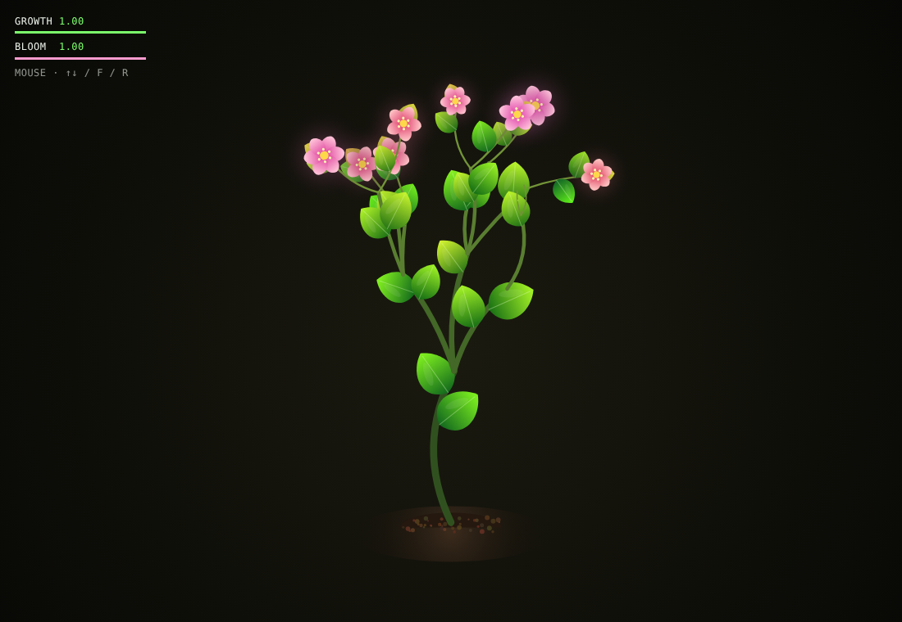

# Gesture Plant · 手势植物生长



用手势控制一株程序生成的植物：生长、回收、开花。灵感来自 TouchDesigner 手势追踪 + 植物生长视频，这里改为纯网页实现（MediaPipe Hand Landmarker + Canvas 2D + Web Audio），无需安装任何软件。

## 手势

| 手势 | 效果 |
|---|---|
| 右手（画面右侧）拇指与食指**张开** | 植物生长，张得越开长得越高 |
| 右手拇指与食指**捏合** | 植物回收（缩回种子） |
| 左手（画面左侧）拇指与食指**张开** | 开花（植物长满后花苞才会打开） |
| 左手捏合 | 花朵合拢 |
| **握拳** | 快速收回（双手握拳：全部回收） |

只出现一只手时，按它在画面中的位置判断：右半边控制生长，左半边控制开花。

植物动起来时，叶尖之间会出现白色细线连接（参考视频中的连线效果），同时有随生长变化的环境音。

## 鼠标 / 键盘模式（无摄像头时）

- 鼠标按住上下拖动：生长
- 滚轮：开花
- `↑` `↓`：生长 ±10%
- `F`：开花 / 收花
- `R`：随机生成一株新植物

## 运行

摄像头需要 HTTPS 或 localhost：

```bash
# 任选其一
python3 -m http.server 8000
npx serve .
```

然后打开 http://localhost:8000 。

也可以在仓库 Settings → Pages 里开启 GitHub Pages（Branch: main, / root），直接在线访问。

首次加载会从 CDN 下载 MediaPipe 模型（约 7 MB），需联网。

## 结构

全部代码在 `index.html` 一个文件里：

- **植物模型**：递归分枝，每根枝条在全局生长轴 `[0,1]` 上有自己的起始时间和时长，所以生长值降低时植物会按相反顺序自然缩回。
- **叶片 / 花朵**：贝塞尔曲线绘制，花瓣随 bloom 值展开。
- **手势**：拇指尖(4)–食指尖(8)距离 ÷ 手掌尺寸(0–9)，归一化后平滑插值。
- **声音**：Web Audio 低通滤波和弦，滤波频率跟随生长，开花时加入铃音。

可调参数：`makeBranch` 中的分枝层数、叶片大小，`pinchOpen` 中的灵敏度区间。
