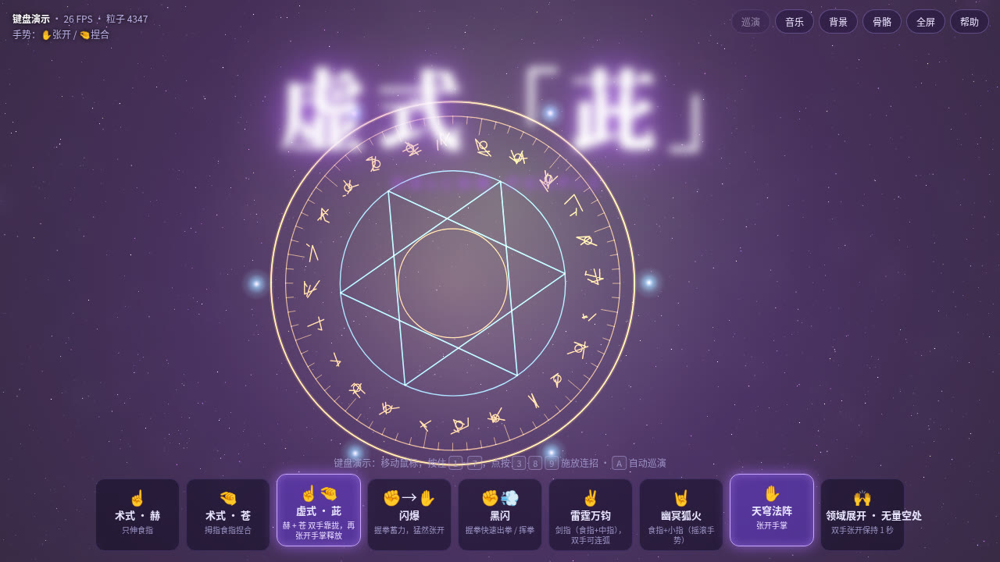

# 咒术回响 · Gesture Sorcery

摄像头手势法术交互系统。抬起双手即可召唤 9 种法术：赫、苍、虚式·茈、闪爆、黑闪、雷霆、狐火、法阵、领域展开。画面粒子、泛光和电弧都实时渲染，配乐与音效也全部由 Web Audio 实时合成。手势识别在本机完成，不上传任何画面。



## 运行（无需安装、无需联网）

1. 下载并解压 `gesture-sorcery.zip`（或下载整个仓库）。
2. 用 **Chrome / Edge** 双击打开 `index.html`。
3. 点「开启摄像头施法」，允许摄像头权限。

如果浏览器不允许 `file://` 页面使用摄像头，可以改用本地服务器启动：
- Windows：双击 `start.cmd`
- macOS / Linux：运行 `./start.sh`

这两个脚本需要本机已安装 Python 3 或 Node.js，启动后会打开 http://localhost:8765 。

没有摄像头也可以体验：点「键盘演示」或「自动演示」。

## 法术手册

| 法术 | 手势 | 键盘演示 |
| --- | --- | --- |
| 术式 · 赫 | ☝️ 只伸食指，指尖凝聚赤红斥力球 | 按住 1 |
| 术式 · 苍 | 🤏 拇指食指捏合，生成吞噬粒子的蓝色引力奇点 | 按住 2 |
| 虚式 · 茈 | 一只手 ☝️ 赫，另一只手 🤏 苍，双手靠拢融合；再张开手掌 ✋ 释放 | 点按 3 |
| 闪爆 | ✊ 握拳蓄力（越久越强），猛然张开 ✋ | 按住 4 后松开 |
| 黑闪 | ✊ 握拳快速挥出 / 朝镜头出拳 | 点按 9 |
| 雷霆万钧 | ✌️ 剑指放电；双手剑指在两手间连弧 | 按住 5 |
| 幽冥狐火 | 🤘 食指 + 小指 | 按住 6 |
| 天穹法阵 | ✋ 张开手掌 | 按住 7 |
| 领域展开 · 无量空处 | 🙌 双手同时张开保持 1 秒 | 点按 8 |

快捷键：`A` 自动巡演，`M` 音乐，`B` 摄像头背景，`K` 手部骨骼，`H` 隐藏界面，`F`/双击 全屏，`/` 帮助。

## 技术

- MediaPipe Hand Landmarker（双手 21 点）：WASM 与模型都已打包在 `js/vendor/`，离线可用
- WebGL2 点精灵粒子（最多 4.2 万）+ 多级泛光；Canvas 2D 绘制电弧、法阵、冲击波
- Web Audio 实时合成暗黑史诗配乐，以及 13 种一次性音效和 8 种持续音层
- 帧率低于 40 FPS 时自动降低粒子数量

## 开发

```bash
npm test               # 手势分类单元测试
npm run build:vendor   # 重新下载并校验 MediaPipe 资源（SHA-256）
npm run pack           # 生成 dist/gesture-sorcery.zip
```
