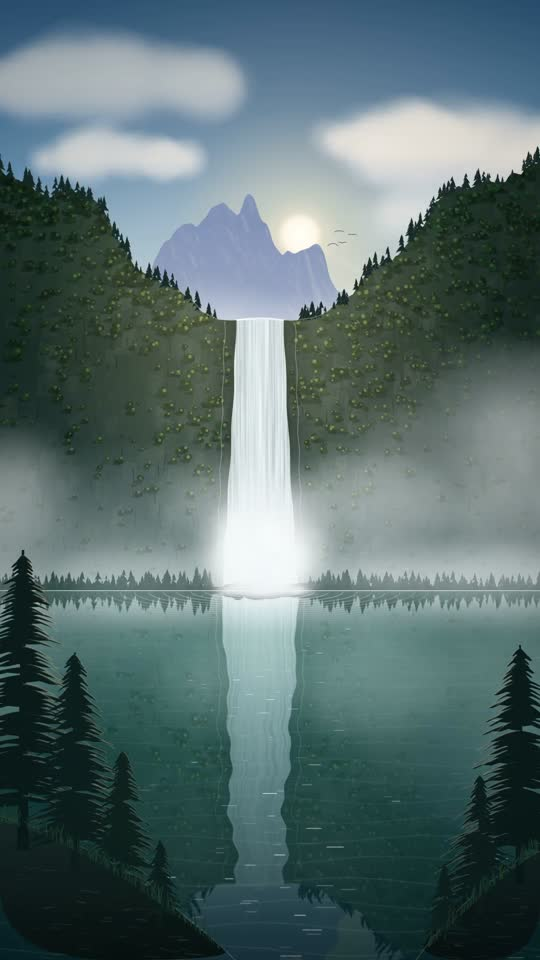

# 山涧飞瀑 · 9:16 手机动态壁纸

纯代码实时渲染（HTML5 Canvas，无任何图片素材）的竖屏动态风景：

- **瀑布**：自峡口直泻而下，三层水纹以不同速度下落，底部白沫翻涌、水雾升腾
- **湖水**：碧色湖面实时倒映山崖与瀑布，逐行波动扰动；波光闪烁、细浪推进、潭心涟漪扩散
- **云雾**：高空云朵缓慢飘移，山间三层雾带穿插缭绕，湖面薄雾
- **飞鸟**：近处雁阵 + 远处小鸟群，振翅/滑翔交替，循环飞过天际
- 逆光暖阳、光束、山脊松林、前景古松

## 文件

| 文件 | 用途 |
|---|---|
| `index.html` | 实时动画网页（无限不重复，可全屏） |
| `waterfall-wallpaper.mp4` | 1080×1920 · 30fps · 18 秒无缝循环视频，用于设置动态壁纸 |
| `preview.jpg` | 预览图 |

## 设为手机壁纸

- **安卓**：大多数系统相册/主题里可直接把 MP4 设为“视频壁纸”；或使用 Video Live Wallpaper 类应用。
- **iPhone**：iOS 需 Live Photo 格式——用 intoLive 等应用把 MP4 转成实况照片，再在“设置 → 墙纸”中选取。
- **网页版**：手机浏览器打开 `index.html`，点一下进入全屏；也可“添加到主屏幕”。在高瘦屏幕上自动铺满裁切，在宽屏上居中显示 9:16 画面。

## 重新录制视频

`index.html?capture` 进入录制模式（固定 1080×1920，暴露 `window.__step(dt)` 逐帧推进），可用 Playwright 逐帧导出后交给 ffmpeg 编码。
